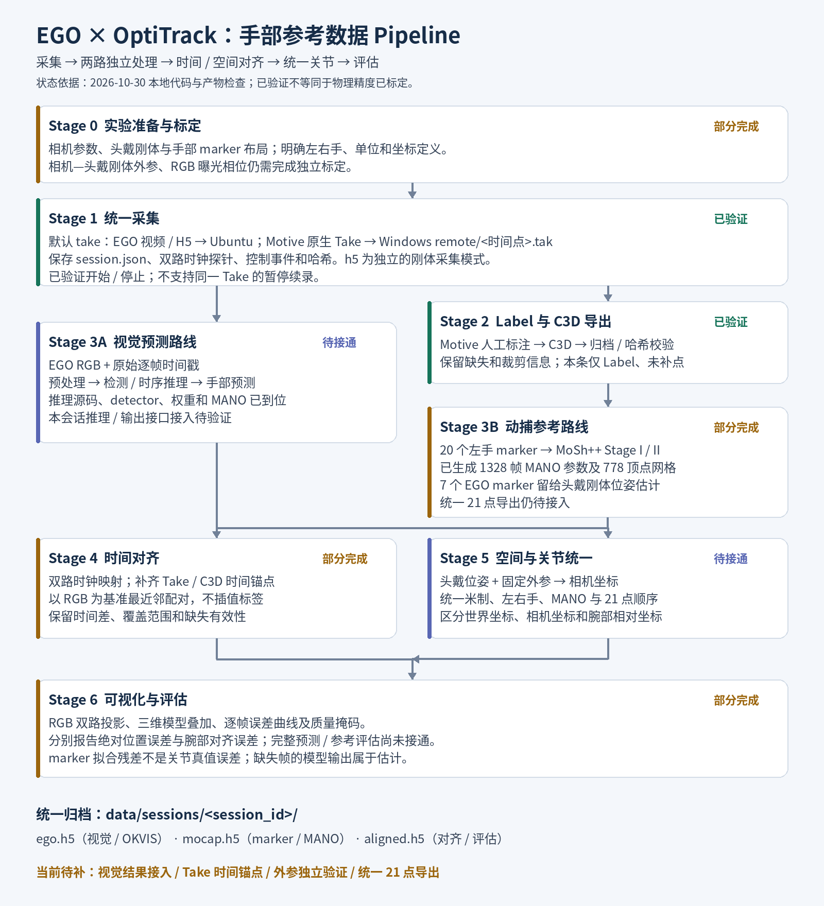

# EGO × OptiTrack 手部参考数据 Pipeline

通过同次采集的 EGO 图像与 OptiTrack 手部 marker，分别获得视觉预测和 MoSh++ / MANO 参考结果；统一时间、空间与关节定义后，进行可视化和误差评估。

更新日期：**2026-10-30（Asia/Shanghai）**。本文状态以本地代码和实际产物为准；完成采集或模型拟合不代表已经完成物理同步、关节真值验证或最终精度评测。

## Pipeline 总览



图片保存在 [`docs/images/pipeline.png`](docs/images/pipeline.png)。重绘脚本为 [`tools/render_pipeline.py`](tools/render_pipeline.py)，使用 Pillow 和 Noto CJK 字体，当前机器可运行 `/usr/bin/python3 tools/render_pipeline.py`。

| Stage | 输入 → 输出 | 当前状态 |
|---|---|---|
| 0：实验准备与标定 | 相机、marker 布局 → 标定与接口约定 | 相机—刚体外参、RGB 曝光相位待标定 |
| 1：统一采集 | EGO + Motive → 原始文件、时钟探针、会话清单 | Take 模式已完成实机短录制；H5 模式已有历史产物 |
| 2：Label 与导出 | Take → 带标签 C3D | 本次数据已导出、复制并校验哈希 |
| 3A：视觉预测 | RGB → 手部预测 | 推理源码与模型资源已到位；本会话结果接入待验证 |
| 3B：动捕参考 | 20 个 marker → MANO 参数、网格 | 本次 1328 帧已有结果；统一 21 点导出待接入 |
| 4：时间对齐 | 两路原始时间 → RGB 参考帧配对 | H5 路线已有实现；Take/C3D 时间锚点待补齐 |
| 5：空间与关节统一 | 两路结果 → 相同坐标系、21 点定义 | 尚未完整接通 |
| 6：可视化与评估 | 配对结果 → 叠加展示、质量与误差报告 | 基础播放器已有；完整双路评估待接通 |

## 命令使用约定

以下命令在 Ubuntu 的同一个 Bash 终端按阶段执行。示例使用已存在的会话；处理新采集时，将 `SESSION` 改成录制命令输出的实际会话 ID。两个录制模式二选一，离线阶段只选择适用路线。

```bash
cd /home/current/syz/ego_hand_ground_truth
pixi install
export PROJECT="$PWD"
export PY="$PROJECT/.pixi/envs/default/bin/python"
export SESSION=20261030_152704_299c41
export SESSION_DIR="$PROJECT/data/sessions/$SESSION"
export VERSION="$(date +%Y%m%d_%H%M%S)"
# C3D导入的可选依赖，只需安装一次
"$PY" -m pip install -e '.[c3d]'
```

同一阶段重新处理时更换 `VERSION`；已有版本拒绝覆盖。下文 `/path/to/...` 是必须替换的输入路径。命令负责不同步骤，不能将整篇所有代码块直接串行执行。

## Stage 0 — 实验准备与标定

- 确认 EGO 相机内参、畸变、旋转/镜像、视频帧与 H5 时间戳的对应关系。
- 配置头戴刚体和手部 marker。本次 C3D 有 7 个 EGO marker、20 个左手 marker。
- 标定相机与头戴刚体之间的固定外参，独立验证 RGB 时间戳与物理曝光的关系。
- 明确视觉模型输出的单位、尺度、左右手、坐标系和关节顺序。

头戴设备持续运动，不能用初始头戴位姿代替逐帧轨迹。20 个手部表面 marker 也不能直接当作 21 个解剖关节点。

先检查设备与参数（不启动录制）：

```bash
adb devices
ssh -o BatchMode=yes windows-pc whoami
cat "$PROJECT/configs/network/lab.json"
./mocap record --help
```

需要采集外参标定素材时，在已启动 Router 与 NatNet publisher 的前提下运行：

```bash
./mocap calibrate ego record --output "calibration/ego_$VERSION" --camera-id cam0_optical
```

此命令只收集静止组素材，不自动求解外参；实际相机 ID、图像导入及前置服务见下文。

相关说明：[外参标定采集](docs/ego标定数据采集.md)、[同步审查记录](docs/时间同步审查测试记录_20261029.md)。

## Stage 1 — 统一采集

### 主流程：EGO + Windows Take（默认）

```bash
./mocap record                 # Ctrl+C 停止并保存
./mocap record --duration 5    # 定时录制5秒
./mocap record --mode take
```

- Ubuntu 保存 EGO 原始 H5、视频、元数据、两路时钟探针及控制事件。
- Windows 保存原生 Take，默认路径为 SSH 登录用户的 `~/Desktop/syz/ego-hand/remote/<时间点>.tak`。
- 时间点格式为北京时间 `YYYYMMDD_HHMMSS_ffffff`；根目录复用，不创建会话子目录。
- `session.json` 关联本地 `session_id` 与 Windows 实际 Take 路径、大小及 SHA-256。
- 命令负责开始和停止录制，**尚不支持同一 Take 的暂停/续录**；软件协调启动不等于硬件同时曝光。

Motive 需已打开并启用 NatNet，EGO 可通过 ADB 访问，`ssh windows-pc` 需免交互连接。Take 模式通过 NatNet 控制及检查录制状态，通过 SSH 检查保存文件。可用 `--windows-take-root 'D:\MocapSessions'` 覆盖默认目录。

### 另一种方法：EGO + Ubuntu H5

```bash
./mocap record --mode h5 --duration 5
```

该模式在 Ubuntu 保存 `mocap.h5`，不控制 Motive Take 录制。当前写入器保存刚体及其时间字段，不等同于本次手部 20 marker 的 C3D 输入。两种模式互斥，不自动同时生成 Take 和动捕 H5。

### 录制结束：EGO自动汇总到本地

按一次 Ctrl+C 后等待命令完成导出；程序自动通过 ADB 拉取 EGO 数据、校验哈希，并整理为会话根目录的 `ego.h5`、`video/` 和 `capture/ego_export/`。无需另跑拉取命令。H5模式同时保存本地 `mocap.h5`；Take原件默认留在Windows。

```bash
# 将SESSION替换为本次录制输出的ID，再刷新目录变量
export SESSION_DIR="$PROJECT/data/sessions/$SESSION"
"$PY" -m json.tool "$SESSION_DIR/session.json"
ls -lh "$SESSION_DIR"
```

检查会话 `status`、`errors` 和资产清单；若自动导出失败，当前尚无独立的通用续传CLI，应保留设备源数据和失败会话排查，不能将失败会话当完整样本。

详细前提、异常处理与目录见 [联合数据采集](docs/联合数据采集.md)。

## Stage 2 — Motive Label、C3D 导出与归档

1. 在 Motive 中打开本次 Take，人工完成 Label，检查跳点、错标和缺失。
2. 导出 C3D，记录是否裁剪、起止帧及是否使用 Gap Fill、平滑等操作。
3. 将导出文件与 Take 关联，复制到本地会话的 `labeled.c3d`，校验哈希并加入资产清单。
4. 检查单位、采样率、帧数、标签映射和有效性；原始文件不改写。

### 从Windows拉取C3D并转为本地动捕H5

先在Motive中完成上述人工操作，并将C3D导出到 `remote`。以下示例的文件名必须与本地会话清单对应，不能按“最新文件”猜测：

```bash
export TAKE_STEM=20261030_152705_108660
# remote路径相对于Windows SSH登录用户主目录；先拉到临时目录
export TRANSFER_DIR="$(mktemp -d /tmp/ego-mocap-transfer.XXXXXX)"
scp "windows-pc:Desktop/syz/ego-hand/remote/${TAKE_STEM}.c3d" "$TRANSFER_DIR/"
sha256sum "$TRANSFER_DIR/${TAKE_STEM}.c3d"
# 比对Windows端同一文件的SHA-256（以下为本次样本文件名）
ssh windows-pc 'powershell -NoProfile -Command "Get-FileHash -Algorithm SHA256 -LiteralPath $HOME/Desktop/syz/ego-hand/remote/20261030_152705_108660.c3d"'

# 仅首次导入执行；已有mocap.h5时拒绝覆盖
"$PY" "$PROJECT/tools/import_session_data.py" c3d \
  --session-dir "$SESSION_DIR" --source "$TRANSFER_DIR/${TAKE_STEM}.c3d"
```

导入器保留原件为 `labeled.c3d`，生成 `mocap.h5` 的原始marker/时间/有效性key并更新会话清单。上例现有会话已经导入，应跳过最后一步。H5录制路线不需要此C3D导入步骤；已有NatNet的 `mocap.h5` 也不能用C3D覆盖。

如需额外备份原生Take到Ubuntu，可选择执行：

```bash
scp "windows-pc:Desktop/syz/ego-hand/remote/${TAKE_STEM}.tak" "$SESSION_DIR/${TAKE_STEM}.tak"
sha256sum "$SESSION_DIR/${TAKE_STEM}.tak"
```

此可选副本不参与离线计算，也不会由 `scp` 自动登记资产；可与 `session.json` 中Windows Take哈希核对。默认仍保留Windows原件。

本次实例：

- 本地会话：`20261030_152704_299c41`；Take/C3D 文件名：`20261030_152705_108660`。
- C3D：120 Hz、1328 帧、单位 m、27 条 marker 轨迹。
- 处理记录为人工 Label、未做 Gap Fill；左手 `MiddleDIP` 在零基帧 587–601 缺失，共15帧。
- 同名文件与会话清单可以证明数据关联，但不能单独证明 RGB 与 C3D 已逐帧同步。

## Stage 3A — EGO 图像到手部预测

```text
RGB视频 + H5原始时间戳
  → 视频帧/时间戳核对
  → 按模型要求预处理、检测、左右手与时序关联
  → 模型推理
  → 预测关节 / MANO参数 / 置信度 / 失败帧标记
```

当前资源目录：`Third_Repo/sch_v21_temporal_weights_v1/`，已检查到：

- `weights/anyhand/wilor/anyhand_wilor.ckpt`
- `WiLoR/pretrained_models/detector.pt`
- `WiLoR/mano_data/MANO_RIGHT.pkl`

配套推理源码已位于 `Third_Repo/sch_v21_temporal_inference_v1/`，包含 `run_benchmark.sh`、`configs/sch_v21_temporal.json` 和双目 AnyHand-WiLoR / 时序 MANO 流程。安装、权重校验和输入格式见[推理包说明](Third_Repo/sch_v21_temporal_inference_v1/README_中文.md)。模型权重、包内环境和推理产物仅保留在本地，不纳入 Git。接入当前会话前仍需核实输出尺度/坐标、左手策略及21点定义。

接入后必须保留原始 `rgb_index`、时间戳、裁剪恢复变换和有效性；算法执行完成时间不作为采样时间。输出通过导入工具写入 `ego.h5::/processing/vision/<version>/`。

### 视觉结果写回ego.h5

推理包入口为其目录下的 `./run_benchmark.sh --config <输入配置> --output <新运行名>`；先按包内说明安装环境、准备权重并填写同一时间基准的左右时间戳及真实双目标定。该入口不自动写入本项目的 H5；产出数值NPZ并适配字段后使用以下导入入口。下面单位/坐标系只适用于**已确认是米制相机坐标**的输出，其他输出必须填写真实约定：

```bash
"$PY" "$PROJECT/tools/import_session_data.py" vision \
  --session-dir "$SESSION_DIR" --source /path/to/vision_predictions.npz \
  --version "$VERSION" --units m --coordinate-frame camera
```

导入不会执行网络推理、自动换算坐标或补齐帧索引。输入NPZ应保留原始时间戳、帧索引与有效性数组。

### 可选：EGO双目惯性位姿（OKVIS）

OKVIS输出设备位姿，不是手势结果。第三方工具需要图像转换目录，使用会话外临时工作区，最终位姿写回 `ego.h5`。原适配器按目录查找H5，因此临时输入只链接 `ego.h5`，避免误选 `mocap.h5` 或 `aligned.h5`。

```bash
export OKVIS_REPO="$PROJECT/Third_Repo/orbslam3_mocap-OKVIS2-X"
export OKVIS_WORK="$(mktemp -d /tmp/ego-okvis.XXXXXX)"
mkdir "$OKVIS_WORK/input"
ln -s "$SESSION_DIR/ego.h5" "$OKVIS_WORK/input/ego.h5"
ln -s "$SESSION_DIR/video" "$OKVIS_WORK/input/video"
(
  set -e
  cd "$OKVIS_REPO"
  # 首次使用需pixi install；若没有build/okvis_app_synchronous，按第三方README构建
  pixi run python tools/head_dataset/head_to_okvis.py \
    --dataset "$OKVIS_WORK/input" --output "$OKVIS_WORK/export" --acc-noise 0.05
  pixi run python tools/head_dataset/verify_export.py "$OKVIS_WORK/export"
  pixi run bash tools/head_dataset/run.sh "$OKVIS_WORK/export" "$OKVIS_WORK/run"
)
# 上面全部成功后再导入
"$PY" "$PROJECT/tools/okvis_pose_to_h5.py" \
  "$OKVIS_WORK/run" "$SESSION_DIR" --version "$VERSION"
```

转换验证针对现有M900配置；噪声与IMU时间偏移沿用历史配置，不等于本次实测标定。检查通过并完成导入后可自行清理临时工作区；独立回放仍需要其中的转换图像。详见 [OKVIS适配器说明](Third_Repo/orbslam3_mocap-OKVIS2-X/tools/head_dataset/README.md)。

## Stage 3B — 动捕 marker 到 MoSh++ / MANO 参考结果

算法环境位于：

```text
/home/current/syz/optitrack4mano/moshpp-main-env
```

该算法保留独立环境；官方求解器依赖 Python 3.7 的扩展，不能直接混用本项目 Python 环境。

```text
C3D → 提取左手20个marker → 标签映射、单位核对、保留NaN
    → Stage I：手形与marker布局估计
    → Stage II：逐帧姿态和平移估计
    → MANO参数与网格 → 统一21点导出（待接入）
```

本次实际运行目录为 `moshpp-main-env/runs/20261030_152705_108660/`，已有：

| 文件 | 内容 |
|---|---|
| `input_manifest.json`、`capture.npz` | 输入来源、哈希、标签映射和缺失观测 |
| `work/stagei.pkl`、`work/stageii.pkl` | MoSh++ 两阶段结果 |
| `20261030_152705_108660_mano.npz` | 1328帧姿态和平移、10维形状参数 |
| `hand_mesh_sequence.npz` | 每帧778顶点的手部网格，单位m |
| `quality_report.json`、`marker_distances_mm.npy` | 可见marker的拟合残差与缺失信息 |

报告中平均 marker 距离约0.390 mm、P95约0.732 mm。**这是拟合残差，不是关节真值精度或视觉预测误差。** marker 距皮肤1 mm仍是未实测假设；缺失期间的模型姿态属于估计。

7个EGO marker不参与手部拟合，应保留用于Stage 5的头戴刚体位姿估计。外部算法结果已导入本会话 `mocap.h5::/processing/mano/moshpp-20261030-v1/`，原始 marker 保留在 `/raw/markers/`。

### 复现现有样本的MoSh++离线求解

以下是**固定样本 `20261030_152705_108660` 的复现命令**，不是任意C3D通用CLI。`prepare.py` 固定读取算法仓库 `capture_checks/20261030_152705_108660/` 下的C3D；先核对其哈希与本地 `labeled.c3d` 一致。新数据需要适配输入路径、标签映射、左右手及配置；当前尚无自动创建这些配置的入口。不要把新C3D覆盖到本例路径。

```bash
export MOSH_ROOT=/home/current/syz/optitrack4mano/moshpp-main-env
export MOSH_RUN="$MOSH_ROOT/runs/20261030_152705_108660"
sha256sum "$SESSION_DIR/labeled.c3d" \
  "$MOSH_ROOT/capture_checks/20261030_152705_108660/20261030_152705_108660.c3d"
(
  set -e
  cd /home/current/syz/optitrack4mano
  export PYTHONPATH="$MOSH_ROOT/source/src"
  export OPENBLAS_NUM_THREADS=1 OMP_NUM_THREADS=1
  MOSH_PY="$MOSH_ROOT/py37/.pixi/envs/default/bin/python"
  "$MOSH_PY" "$MOSH_RUN/prepare.py"   # 选取20个左手marker，保留缺失
  "$MOSH_PY" "$MOSH_RUN/run.py"       # Stage I + Stage II，已有结果会复用
  "$MOSH_PY" "$MOSH_RUN/validate.py"  # 校验、导出MANO参数及质量报告
  "$MOSH_PY" "$MOSH_RUN/preview.py"   # 导出网格和预览图
)
```

已经有拟合产物时可跳过求解，直接汇总到本地会话：

```bash
"$PY" "$PROJECT/tools/import_session_data.py" mano \
  --session-dir "$SESSION_DIR" \
  --source "$MOSH_RUN/20261030_152705_108660_mano.npz" \
  --mesh "$MOSH_RUN/hand_mesh_sequence.npz" \
  --quality-json "$MOSH_RUN/quality_report.json" \
  --version "$VERSION" --units m --coordinate-frame mocap_world
```

输出在 `mocap.h5::/processing/mano/<version>/`。算法自身的中间文件仍位于独立算法仓库，本项目不为每次算法运行新增数据子目录。

## Stage 4 — 时间映射与帧配对

参考时间轴为 Ubuntu `CLOCK_MONOTONIC`。采集期间保存四时间戳探针，离线拟合 EGO、Windows 到 Ubuntu 的偏移和漂移。

- **H5路线已有实现**：使用RGB时间和NatNet曝光中点时间，映射后最近邻配对；每帧保留时间差、覆盖、外推与跟踪有效性。
- **Take路线仍需时间锚点**：明确C3D帧号与Take原始帧、Windows采样时钟之间的关系。当前Take模式没有保存逐帧NatNet曝光时间，不能直接套用已有H5对齐工具。
- RGB物理曝光相位尚未标定，不能把较小的最近邻时间差当作真实物理同步误差。

不要将C3D第0帧直接对应RGB第0帧，也不要用开始命令发送时间代替首帧曝光时间。最终标签采用最近邻，不进行时间插值；MoSh++对缺失观测的模型估计另行标记。

H5路线入口：`python -m joint_capture.alignment <session_id>`（在项目依赖环境运行）。输出进入 `aligned.h5::/processing/sync/<version>/`；随后用 `tools/export_aligned_h5.py` 写入同文件的 `/processing/alignment/<version>/`。旧版 [时间同步方案](docs/时间同步方案.md) 包含尚未接入的运动互相关建议，不代表当前入口已实现全部内容。

下面用已验证的NatNet会话演示；不要对上面的Take/C3D会话执行：

```bash
export SYNC_SESSION=20261029_154054_b79801
export SYNC_VERSION="sync_$(date +%Y%m%d_%H%M%S)"
"$PY" -m joint_capture.alignment "$SYNC_SESSION" --version "$SYNC_VERSION"
"$PY" "$PROJECT/tools/export_aligned_h5.py" "$SYNC_SESSION" --version "$SYNC_VERSION"
```

第一条计算时钟模型与配对表，第二条将按索引取出的动捕观测写入同一个 `aligned.h5`。新H5采集替换 `SYNC_SESSION` 即可；Take时间锚点适配仍未实现。

## Stage 5 — 空间变换与统一21点

约定 `T_AB` 将B系点变换到A系；W为动捕世界系，B为头戴刚体系，C为实际使用的相机系。

```text
p_C_ref(t) = inverse(T_WB(t) · T_BC) · p_W_ref(t)
```

- `T_WB(t)`：由头戴刚体/7个EGO marker估计的逐帧位姿。
- `T_BC`：相机到头戴刚体的固定外参。`config/ego_left_rgb_extrinsics.json` 已有完整候选，状态为 `candidate_not_independently_validated`，仍需独立采集验证，不能作为高精度真值。
- 头戴刚体缺失或拟合失败时，保留无效标记，不使用初始位姿替代。
- 两路统一MANO版本、左右手、米制、关节顺序及腕点/指尖定义。
- 若视觉模型只输出腕部相对坐标或不确定尺度，先明确其接口；不能直接与世界坐标计算绝对误差。

如视觉结果在每段初始化的EGO世界系中，还需建立该世界系与动捕世界系的关系并处理漂移。OKVIS位姿可作为相关辅助数据，但不能代替手部预测或固定外参标定。

空间变换输出计划写入 `aligned.h5::/processing/spatial/<version>/`，同时保留原始帧索引、变换链、时间差和质量掩码。

当前没有完成空间统一、21点导出的一键命令；本阶段需先完成外参及输出接口，不能用占位命令生成可评估结果。

## Stage 6 — 可视化、质量检查与评估

计划展示RGB上的预测/参考投影、三维手部模型叠加，以及误差、时间差和缺失随时间的变化。分别报告绝对位置误差与腕部对齐后的姿态误差；额外旋转/尺度对齐的指标单独列出。

```bash
./mocap visualize
```

现有播放器地址为 `http://127.0.0.1:8765`，支持统一 motion JSON、NatNet/对齐H5及C3D导入后的marker H5。它支持三H5内部版本中的视觉/MANO网格、按原始RGB索引和逐帧刚体位姿在加载时转换坐标；外参候选状态会明确显示。它**不会直接从原始EGO H5重建手，也不会直接加载上述MANO NPZ或原生Take**；NPZ须先导入H5。详见 [可视化说明](docs/motion_web.md)。

播放器中选择会话与对齐版本；C3D只显示marker，不能当21点骨架。最终双路误差评估尚无CLI。可用以下命令检查三个H5实际包含的处理阶段：

```bash
"$PY" - "$SESSION_DIR" <<'PYCODE'
from pathlib import Path
import sys, h5py
for name in ('ego.h5', 'mocap.h5', 'aligned.h5'):
    path = Path(sys.argv[1]) / name
    if not path.exists():
        print(name, '尚未生成')
        continue
    with h5py.File(path) as f:
        print(name, {stage: list(group) for stage, group in f.get('processing', {}).items()})
PYCODE
```

## 目录组织与追溯

```text
data/
├── sessions/<session_id>/
│   ├── session.json       # 资产清单、来源与当前哈希
│   ├── ego.h5             # 原始传感器 + processing/vision、processing/okvis
│   ├── mocap.h5           # 原始动捕 + processing/mano
│   ├── aligned.h5         # processing/sync、alignment；后续 spatial、evaluation
│   ├── video/             # 原始视频
│   ├── labeled.c3d        # Take路线标注导出原件
│   ├── clocks/            # 双路时钟探针
│   └── capture/           # 控制日志、原始导出元信息和迁移记录
├── unassigned/            # 无法可靠关联会话的独立采集
└── samples/               # 格式示例，非实验真值
```

只生成实际存在的数据：Take尚未导入C3D时没有 `mocap.h5`；尚未对齐时没有 `aligned.h5`。两种采集模式保持 `take`（默认）与 `h5`。Windows仍保存 `~/Desktop/syz/ego-hand/remote/<时间点>.tak`。

算法重处理在 H5 内使用 `/processing/<stage>/<version>/`，不新建算法目录。同名版本拒绝覆盖；写入使用文件锁与临时副本替换，保留原始数据，并更新清单哈希。旧数据根key保持兼容，不强制改名。历史CSV、配置和日志也随对应内部版本归档。详细字段与命令见 [三H5数据格式](docs/三H5数据格式.md)。

## 接下来按顺序接通

1. 使用已到位的视觉推理包，确认输入/输出接口，完成本次EGO视频推理及H5结果接入。
2. 为Take/C3D建立可验证的时间锚点，补齐RGB曝光参考标定。
3. 完成相机—头戴刚体外参及逐帧头戴位姿恢复。
4. 导出两路统一21点，关联质量掩码，再实现叠加展示与评估。

## 分工与历史资料

- 孙祎喆：动捕链路、marker、相机刚体标定、MANO参考与离线对齐。
- 石晨浩：EGO手部识别、21点输出接口及联合评估。

[目录迁移说明](docs/数据目录重组_20261029.md)、[旧版数据流](docs/项目数据流.md)、[接手说明](docs/关键上下文与接手说明.md)、[代码迁移](docs/code_migration.md) 保留历史背景；其中旧状态以本文及最新运行记录为准。

原始需求来源：[飞书文档](https://vcnqhq28cfdm.feishu.cn/docx/SyU7dqjtloMpSKxOMXZcFXKRnac)。本地快照已于2026-10-30通过lark-cli更新，不会自动同步后续飞书变更。第三方源码与环境保留在原路径，数据和模型资源不因本文更新而移动。

### 无标定板的 RBC / tBC 引导录制

先录制旋转标定，再录制平移标定；两次采集之间保持设备与 marker 的安装关系不变，不要重新定义 Motive 刚体原点。

```bash
./mocap record --calibration rbc
./mocap record --calibration tbc
```

指定 `--calibration` 会自动选择 `--mode h5`。普通 `./mocap record` 的默认 Take 模式保持不变。

- **RBC：118 秒。** 初始静止 5 秒，左右转约 ±40°、俯仰约 ±30°、侧倾约 ±25°，每个轴重复 3 轮，结束静止 5 秒。
- **tBC：236 秒。** 在中心、左前方、右前方三个位置重复三轴动作，每个轴 2 轮，换位置预留 5 秒；位置相对中心约 20～30 cm。平移标定仍需充分旋转。
- 每个方向转动 2 秒、保持 2 秒、回正 2 秒。角度和位置为提示值，无需精确达到；保证图像清晰、场景静止且有丰富纹理、动捕无遮挡。
- 录制确认启动后才开始引导。终端每秒显示当前动作及倒计时，完成后自动停止和导出。调度延迟会延长实际时长，不会跳过动作。

默认分别保存到项目目录下：

```text
data/sessions/calibration_rbc_<时间>_<随机后缀>/
data/sessions/calibration_tbc_<时间>_<随机后缀>/
```

每个目录保留原有 `ego.h5`、`mocap.h5`、视频及对时记录，另有 `capture/calibration_guide.json`，保存完整动作计划、实际提示起止时间及完成状态。时间域为 Ubuntu `CLOCK_MONOTONIC`，与采集事件一致；这些边界只表示提示的时间，不表示已经检测到真实动作或静止，也不等于曝光时间。离线标定仍需从轨迹判断实际稳定区间。`capture/events.jsonl` 同时记录动作切换。

可使用 `--session-id` 自定义目录名，已有目录不会覆盖。Ctrl+C 会停止并保存已有数据，但流程未完成会标记 `calibration_incomplete`，会话状态为 `failed`，不应作为完整标定采集使用。引导模式不接受 `--duration`、`--mode take` 或 `--no-clock-probes`。

连接设备前可预览动作表；预览不会连接设备、创建会话或启动录制：

```bash
./mocap record --calibration rbc --preview-calibration
./mocap record --calibration tbc --preview-calibration
```

本功能负责采集与动作标记，录制结束不会自动运行 SLAM 或求解外参。
