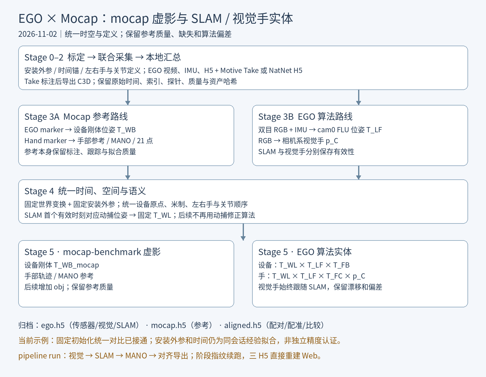

# EGO × Mocap：设备与手部算法对比 Pipeline

以 mocap 的 EGO 设备刚体位姿和手部位姿为参考，对比 EGO 的 SLAM 与始终跟随 SLAM 的视觉手部算法，统一到动捕世界系可视化。Mocap 是有质量信息的参考系统，不把 marker 拟合残差当作关节真值精度。

更新日期：**2026-11-02（Asia/Shanghai）**。当前完整示例为 `20261030_182714_db5456`；下文部分采集/导入命令沿用 `20261030_152704_299c41` 历史样本，二者的帧数和指标不可混用。

## Pipeline 总览



详细坐标链、评估边界与数据组织见 [统一对比 Pipeline](docs/comparison_pipeline.md)。重绘：`/usr/bin/python3 tools/render_pipeline.py`（需要 Pillow 和 Noto CJK 字体）。

| Stage | 输入 → 输出 | 当前完整示例状态 |
|---|---|---|
| 0：标定与约定 | 相机/IMU/marker → 安装外参、时间与关节定义 | 候选外参；独立验证待完成 |
| 1：联合采集 | EGO + Motive → H5、视频、Take、探针、清单 | 已采集；take 默认，h5 可选 |
| 2：本地汇总 | Take 标注导出 C3D，EGO 文件回传 | 归档三 H5，保留原始文件与哈希 |
| 3A：Mocap 参考 | EGO marker → 设备位姿；手部 marker → MANO/21点 | 5347 帧，27 marker |
| 3B：EGO 算法 | RGB+IMU → SLAM；RGB → 相机系手部预测 | OKVIS 1291 位姿；左手186/1293有效 |
| 4：时空统一 | 时间对应、固定安装与世界变换、单位/左右手/关节顺序 | 本会话经验配准；曝光级同步未验证 |
| 5：统一对比 | mocap设备/手虚影 ↔ SLAM设备/视觉手实体 | 固定初始化世界关系；独立安装与时间标定待完成 |

## 单一统一对比：mocap 虚影与 EGO 算法实体

- **mocap-benchmark 虚影**：EGO-device 完整 URDF 虚影与 hand 轨迹；设备安装必须与会话刚体模板兼容。
- **算法实体**：SLAM 设备轨迹与视觉手；视觉手始终基于 SLAM 位姿，不使用 mocap 设备位姿定位。
- IMU、左右光心、EGO 原点和局部轴为辅助层。世界统一 Z-up、单位米，缺失结果隐藏。

### 初始化时建立固定世界关系

T_AB 表示 B→A。W=动捕世界，L=新版SLAM的FLU世界，F=cam0的FLU坐标，I=IMU，B=marker刚体，C=左相机光学RDF坐标。

```text
T_FC：光学 RDF → cam0 FLU，(x,y,z) → (z,-x,-y)
T_FB = T_FC @ inverse(T_IC) @ T_IB
T_WL = T_WB_mocap(t0) @ inverse(T_LF_SLAM(t0) @ T_FB)
算法设备：T_WB(t) = T_WL @ T_LF(t) @ T_FB
算法手：p_W(t) = T_WL @ T_LF(t) @ T_FC @ p_C(t)
```

`t0` 是首个有效且有对应动捕观测的 SLAM 输出，不是录制命令时刻。初始化参考位姿按时间插值，之后固定 T_WL，不再用后续动捕修正算法设备或手。录制阶段本身不会运行 SLAM 或重置 Motive 原点。

### 当前示例运行

```bash
cd /home/current/syz/ego_hand_ground_truth
./mocap pipeline run --session 20261030_182714_db5456 --profile config/pipeline/20261030_182714_db5456.json
.pixi/envs/default/bin/python -m http.server 8767 --bind 127.0.0.1 --directory reports/session_20261030_182714_db5456/world3d
```

打开 http://127.0.0.1:8767/ 。run 编排算法与导出；已有完成阶段按指纹复用，Web 直接从三 H5 重建。profile 仍限定本机、本会话与现有 marker 定义。取消此前三个模式；历史构建器 tools/build_comparison_modes.py 不再作为当前入口。

本例选择 SLAM 位姿索引1：EGO相对时间0.099958s，对应动捕0.618485s。固定T_WL与初始化依据保存在world3d/initialization.json；显示缓存为initial_body.bin、initial_vision.bin；初始化和配对另存aligned.h5版本组，不覆盖历史配准版本。

**限制**：此次仅改为初始化确定T_WL；T_IB与+0.518527s时间偏移仍沿用此前全段拟合候选。因此当前仍非独立精度评估。正式实验应提供独立安装标定与可靠时间锚；旧全段拟合的1.27cm/1.12cm残差不能作为新初始化方案的指标。

## 命令使用约定

以下命令在 Ubuntu 的同一个 Bash 终端按阶段执行。示例使用已存在的会话；处理新采集时，将 `SESSION` 改成录制命令输出的实际会话 ID。两个录制模式二选一，离线阶段只选择适用路线。

```bash
cd /home/current/syz/ego_hand_ground_truth
pixi install
export PROJECT="$PWD"
export PY="$PROJECT/.pixi/envs/default/bin/python"
export SESSION=20261030_152704_299c41
export SESSION_DIR="$PROJECT/data/sessions/$SESSION"
export VERSION="$(date +%Y%m%d_%H%M%S)"
# C3D导入的可选依赖，只需安装一次
"$PY" -m pip install -e '.[c3d]'
```

同一阶段重新处理时更换 `VERSION`；已有版本拒绝覆盖。下文 `/path/to/...` 是必须替换的输入路径。命令负责不同步骤，不能将整篇所有代码块直接串行执行。

## Stage 0 — 实验准备与标定

- 确认 EGO 相机内参、畸变、旋转/镜像、视频帧与 H5 时间戳的对应关系。
- 配置头戴刚体和手部 marker。本次 C3D 有 7 个 EGO marker、20 个左手 marker。
- 标定相机与头戴刚体之间的固定外参，独立验证 RGB 时间戳与物理曝光的关系。
- 明确视觉模型输出的单位、尺度、左右手、坐标系和关节顺序。

头戴设备持续运动，不能用初始头戴位姿代替逐帧轨迹。20 个手部表面 marker 也不能直接当作 21 个解剖关节点。

先检查设备与参数（不启动录制）：

```bash
adb devices
ssh -o BatchMode=yes windows-pc whoami
cat "$PROJECT/configs/network/lab.json"
./mocap record --help
```

需要采集外参标定素材时，在已启动 Router 与 NatNet publisher 的前提下运行：

```bash
./mocap calibrate ego record --output "calibration/ego_$VERSION" --camera-id cam0_optical
```

此命令只收集静止组素材，不自动求解外参；实际相机 ID、图像导入及前置服务见下文。

相关说明：[外参标定采集](docs/ego标定数据采集.md)、[同步审查记录](docs/时间同步审查测试记录_20261029.md)。

## Stage 1 — 统一采集

### 主流程：EGO + Windows Take（默认）

```bash
./mocap record                 # Ctrl+C 停止并保存
./mocap record --duration 5    # 定时录制5秒
./mocap record --mode take
```

- Ubuntu 保存 EGO 原始 H5、视频、元数据、两路时钟探针及控制事件。
- Windows 保存原生 Take，默认路径为 SSH 登录用户的 `~/Desktop/syz/ego-hand/remote/<时间点>.tak`。
- 时间点格式为北京时间 `YYYYMMDD_HHMMSS_ffffff`；根目录复用，不创建会话子目录。
- `session.json` 关联本地 `session_id` 与 Windows 实际 Take 路径、大小及 SHA-256。
- 命令负责开始和停止录制，**尚不支持同一 Take 的暂停/续录**；软件协调启动不等于硬件同时曝光。

Motive 需已打开并启用 NatNet，EGO 可通过 ADB 访问，`ssh windows-pc` 需免交互连接。Take 模式通过 NatNet 控制及检查录制状态，通过 SSH 检查保存文件。可用 `--windows-take-root 'D:\MocapSessions'` 覆盖默认目录。

### 另一种方法：EGO + Ubuntu H5

```bash
./mocap record --mode h5 --duration 5
```

该模式在 Ubuntu 保存 `mocap.h5`，不控制 Motive Take 录制。当前写入器保存刚体及其时间字段，不等同于本次手部 20 marker 的 C3D 输入。两种模式互斥，不自动同时生成 Take 和动捕 H5。

### 录制结束：EGO自动汇总到本地

按一次 Ctrl+C 后等待命令完成导出；程序自动通过 ADB 拉取 EGO 数据、校验哈希，并整理为会话根目录的 `ego.h5`、`video/` 和 `capture/ego_export/`。无需另跑拉取命令。H5模式同时保存本地 `mocap.h5`；Take原件默认留在Windows。

```bash
# 将SESSION替换为本次录制输出的ID，再刷新目录变量
export SESSION_DIR="$PROJECT/data/sessions/$SESSION"
"$PY" -m json.tool "$SESSION_DIR/session.json"
ls -lh "$SESSION_DIR"
```

检查会话 `status`、`errors` 和资产清单；若自动导出失败，当前尚无独立的通用续传CLI，应保留设备源数据和失败会话排查，不能将失败会话当完整样本。

详细前提、异常处理与目录见 [联合数据采集](docs/联合数据采集.md)。

## Stage 2 — Motive Label、C3D 导出与归档

1. 在 Motive 中打开本次 Take，人工完成 Label，检查跳点、错标和缺失。
2. 导出 C3D，记录是否裁剪、起止帧及是否使用 Gap Fill、平滑等操作。
3. 将导出文件与 Take 关联，复制到本地会话的 `labeled.c3d`，校验哈希并加入资产清单。
4. 检查单位、采样率、帧数、标签映射和有效性；原始文件不改写。

### 从Windows拉取C3D并转为本地动捕H5

先在Motive中完成上述人工操作，并将C3D导出到 `remote`。以下示例的文件名必须与本地会话清单对应，不能按“最新文件”猜测：

```bash
export TAKE_STEM=20261030_152705_108660
# remote路径相对于Windows SSH登录用户主目录；先拉到临时目录
export TRANSFER_DIR="$(mktemp -d /tmp/ego-mocap-transfer.XXXXXX)"
scp "windows-pc:Desktop/syz/ego-hand/remote/${TAKE_STEM}.c3d" "$TRANSFER_DIR/"
sha256sum "$TRANSFER_DIR/${TAKE_STEM}.c3d"
# 比对Windows端同一文件的SHA-256（以下为本次样本文件名）
ssh windows-pc 'powershell -NoProfile -Command "Get-FileHash -Algorithm SHA256 -LiteralPath $HOME/Desktop/syz/ego-hand/remote/20261030_152705_108660.c3d"'

# 仅首次导入执行；已有mocap.h5时拒绝覆盖
"$PY" "$PROJECT/tools/import_session_data.py" c3d \
  --session-dir "$SESSION_DIR" --source "$TRANSFER_DIR/${TAKE_STEM}.c3d"
```

导入器保留原件为 `labeled.c3d`，生成 `mocap.h5` 的原始marker/时间/有效性key并更新会话清单。上例现有会话已经导入，应跳过最后一步。H5录制路线不需要此C3D导入步骤；已有NatNet的 `mocap.h5` 也不能用C3D覆盖。

如需额外备份原生Take到Ubuntu，可选择执行：

```bash
scp "windows-pc:Desktop/syz/ego-hand/remote/${TAKE_STEM}.tak" "$SESSION_DIR/${TAKE_STEM}.tak"
sha256sum "$SESSION_DIR/${TAKE_STEM}.tak"
```

此可选副本不参与离线计算，也不会由 `scp` 自动登记资产；可与 `session.json` 中Windows Take哈希核对。默认仍保留Windows原件。

本次实例：

- 本地会话：`20261030_152704_299c41`；Take/C3D 文件名：`20261030_152705_108660`。
- C3D：120 Hz、1328 帧、单位 m、27 条 marker 轨迹。
- 处理记录为人工 Label、未做 Gap Fill；左手 `MiddleDIP` 在零基帧 587–601 缺失，共15帧。
- 同名文件与会话清单可以证明数据关联，但不能单独证明 RGB 与 C3D 已逐帧同步。

## Stage 3B — EGO 图像到手部预测

```text
RGB视频 + H5原始时间戳
  → 视频帧/时间戳核对
  → 按模型要求预处理、检测、左右手与时序关联
  → 模型推理
  → 预测关节 / MANO参数 / 置信度 / 失败帧标记
```

当前资源目录：`Third_Repo/sch_v21_temporal_weights_v1/`，已检查到：

- `weights/anyhand/wilor/anyhand_wilor.ckpt`
- `WiLoR/pretrained_models/detector.pt`
- `WiLoR/mano_data/MANO_RIGHT.pkl`

配套推理源码已位于 `Third_Repo/sch_v21_temporal_inference_v1/`，包含 `run_benchmark.sh`、`configs/sch_v21_temporal.json` 和双目 AnyHand-WiLoR / 时序 MANO 流程。安装、权重校验和输入格式见[推理包说明](Third_Repo/sch_v21_temporal_inference_v1/README_中文.md)。模型权重、包内环境和推理产物仅保留在本地，不纳入 Git。接入当前会话前仍需核实输出尺度/坐标、左手策略及21点定义。

接入后必须保留原始 `rgb_index`、时间戳、裁剪恢复变换和有效性；算法执行完成时间不作为采样时间。输出通过导入工具写入 `ego.h5::/processing/vision/<version>/`。

### 视觉结果写回ego.h5

推理包入口为其目录下的 `./run_benchmark.sh --config <输入配置> --output <新运行名>`；先按包内说明安装环境、准备权重并填写同一时间基准的左右时间戳及真实双目标定。该入口不自动写入本项目的 H5；产出数值NPZ并适配字段后使用以下导入入口。下面单位/坐标系只适用于**已确认是米制相机坐标**的输出，其他输出必须填写真实约定：

```bash
"$PY" "$PROJECT/tools/import_session_data.py" vision \
  --session-dir "$SESSION_DIR" --source /path/to/vision_predictions.npz \
  --version "$VERSION" --units m --coordinate-frame camera
```

导入不会执行网络推理、自动换算坐标或补齐帧索引。输入NPZ应保留原始时间戳、帧索引与有效性数组。

### EGO双目惯性位姿（OKVIS）

当前新版统一入口为 `./mocap pipeline run --session <ID> --profile <配置>`，按 cam0 FLU 导入。下面的手动转换与 `okvis_pose_to_h5.py` 命令保留为**原始 IMU 输出的兼容流程**，不可用来导入 cam0 FLU 文件。

OKVIS输出设备位姿，不是手势结果。第三方工具需要图像转换目录，使用会话外临时工作区，最终位姿写回 `ego.h5`。原适配器按目录查找H5，因此临时输入只链接 `ego.h5`，避免误选 `mocap.h5` 或 `aligned.h5`。

```bash
export OKVIS_REPO="$PROJECT/Third_Repo/orbslam3_mocap-OKVIS2-X"
export OKVIS_WORK="$(mktemp -d /tmp/ego-okvis.XXXXXX)"
mkdir "$OKVIS_WORK/input"
ln -s "$SESSION_DIR/ego.h5" "$OKVIS_WORK/input/ego.h5"
ln -s "$SESSION_DIR/video" "$OKVIS_WORK/input/video"
(
  set -e
  cd "$OKVIS_REPO"
  # 首次使用需pixi install；若没有build/okvis_app_synchronous，按第三方README构建
  pixi run python tools/head_dataset/head_to_okvis.py \
    --dataset "$OKVIS_WORK/input" --output "$OKVIS_WORK/export" --acc-noise 0.05
  pixi run python tools/head_dataset/verify_export.py "$OKVIS_WORK/export"
  pixi run bash tools/head_dataset/run.sh "$OKVIS_WORK/export" "$OKVIS_WORK/run"
)
# 上面全部成功后再导入
"$PY" "$PROJECT/tools/okvis_pose_to_h5.py" \
  "$OKVIS_WORK/run" "$SESSION_DIR" --version "$VERSION"
```

转换验证针对现有M900配置；噪声与IMU时间偏移沿用历史配置，不等于本次实测标定。检查通过并完成导入后可自行清理临时工作区；独立回放仍需要其中的转换图像。详见 [OKVIS适配器说明](Third_Repo/orbslam3_mocap-OKVIS2-X/tools/head_dataset/README.md)。

## Stage 3A — 动捕 marker 到 MoSh++ / MANO 参考结果

算法环境位于：

```text
/home/current/syz/optitrack4mano/moshpp-main-env
```

该算法保留独立环境；官方求解器依赖 Python 3.7 的扩展，不能直接混用本项目 Python 环境。

```text
C3D → 提取左手20个marker → 标签映射、单位核对、保留NaN
    → Stage I：手形与marker布局估计
    → Stage II：逐帧姿态和平移估计
    → MANO参数与网格 → 统一21点导出（待接入）
```

本次实际运行目录为 `moshpp-main-env/runs/20261030_152705_108660/`，已有：

| 文件 | 内容 |
|---|---|
| `input_manifest.json`、`capture.npz` | 输入来源、哈希、标签映射和缺失观测 |
| `work/stagei.pkl`、`work/stageii.pkl` | MoSh++ 两阶段结果 |
| `20261030_152705_108660_mano.npz` | 1328帧姿态和平移、10维形状参数 |
| `hand_mesh_sequence.npz` | 每帧778顶点的手部网格，单位m |
| `quality_report.json`、`marker_distances_mm.npy` | 可见marker的拟合残差与缺失信息 |

报告中平均 marker 距离约0.390 mm、P95约0.732 mm。**这是拟合残差，不是关节真值精度或视觉预测误差。** marker 距皮肤1 mm仍是未实测假设；缺失期间的模型姿态属于估计。

7个EGO marker不参与手部拟合，应保留用于Stage 5的头戴刚体位姿估计。外部算法结果已导入本会话 `mocap.h5::/processing/mano/moshpp-20261030-v1/`，原始 marker 保留在 `/raw/markers/`。

### 复现现有样本的MoSh++离线求解

以下是**固定样本 `20261030_152705_108660` 的复现命令**，不是任意C3D通用CLI。`prepare.py` 固定读取算法仓库 `capture_checks/20261030_152705_108660/` 下的C3D；先核对其哈希与本地 `labeled.c3d` 一致。新数据需要适配输入路径、标签映射、左右手及配置；当前尚无自动创建这些配置的入口。不要把新C3D覆盖到本例路径。

```bash
export MOSH_ROOT=/home/current/syz/optitrack4mano/moshpp-main-env
export MOSH_RUN="$MOSH_ROOT/runs/20261030_152705_108660"
sha256sum "$SESSION_DIR/labeled.c3d" \
  "$MOSH_ROOT/capture_checks/20261030_152705_108660/20261030_152705_108660.c3d"
(
  set -e
  cd /home/current/syz/optitrack4mano
  export PYTHONPATH="$MOSH_ROOT/source/src"
  export OPENBLAS_NUM_THREADS=1 OMP_NUM_THREADS=1
  MOSH_PY="$MOSH_ROOT/py37/.pixi/envs/default/bin/python"
  "$MOSH_PY" "$MOSH_RUN/prepare.py"   # 选取20个左手marker，保留缺失
  "$MOSH_PY" "$MOSH_RUN/run.py"       # Stage I + Stage II，已有结果会复用
  "$MOSH_PY" "$MOSH_RUN/validate.py"  # 校验、导出MANO参数及质量报告
  "$MOSH_PY" "$MOSH_RUN/preview.py"   # 导出网格和预览图
)
```

已经有拟合产物时可跳过求解，直接汇总到本地会话：

```bash
"$PY" "$PROJECT/tools/import_session_data.py" mano \
  --session-dir "$SESSION_DIR" \
  --source "$MOSH_RUN/20261030_152705_108660_mano.npz" \
  --mesh "$MOSH_RUN/hand_mesh_sequence.npz" \
  --quality-json "$MOSH_RUN/quality_report.json" \
  --version "$VERSION" --units m --coordinate-frame mocap_world
```

输出在 `mocap.h5::/processing/mano/<version>/`。算法自身的中间文件仍位于独立算法仓库，本项目不为每次算法运行新增数据子目录。

## Stage 4A — 时间映射与帧配对

参考时间轴为 Ubuntu `CLOCK_MONOTONIC`。采集期间保存四时间戳探针，离线拟合 EGO、Windows 到 Ubuntu 的偏移和漂移。

- **H5路线已有实现**：使用RGB时间和NatNet曝光中点时间，映射后最近邻配对；每帧保留时间差、覆盖、外推与跟踪有效性。
- **Take路线仍需时间锚点**：明确C3D帧号与Take原始帧、Windows采样时钟之间的关系。当前Take模式没有保存逐帧NatNet曝光时间，不能直接套用已有H5对齐工具。
- RGB物理曝光相位尚未标定，不能把较小的最近邻时间差当作真实物理同步误差。

不要将C3D第0帧直接对应RGB第0帧，也不要用开始命令发送时间代替首帧曝光时间。最终标签采用最近邻，不进行时间插值；MoSh++对缺失观测的模型估计另行标记。

H5路线入口：`python -m joint_capture.alignment <session_id>`（在项目依赖环境运行）。输出进入 `aligned.h5::/processing/sync/<version>/`；随后用 `tools/export_aligned_h5.py` 写入同文件的 `/processing/alignment/<version>/`。旧版 [时间同步方案](docs/时间同步方案.md) 包含尚未接入的运动互相关建议，不代表当前入口已实现全部内容。

下面用已验证的NatNet会话演示；不要对上面的Take/C3D会话执行：

```bash
export SYNC_SESSION=20261029_154054_b79801
export SYNC_VERSION="sync_$(date +%Y%m%d_%H%M%S)"
"$PY" -m joint_capture.alignment "$SYNC_SESSION" --version "$SYNC_VERSION"
"$PY" "$PROJECT/tools/export_aligned_h5.py" "$SYNC_SESSION" --version "$SYNC_VERSION"
```

第一条计算时钟模型与配对表，第二条将按索引取出的动捕观测写入同一个 `aligned.h5`。新H5采集替换 `SYNC_SESSION` 即可；Take时间锚点适配仍未实现。

## Stage 4B — 空间变换与统一21点

约定 `T_AB` 将B系点变换到A系；W为动捕世界系，B为头戴刚体系，C为实际使用的相机系。

```text
p_C_ref(t) = inverse(T_WB(t) · T_BC) · p_W_ref(t)
```

- `T_WB(t)`：由头戴刚体/7个EGO marker估计的逐帧位姿。
- `T_BC`：相机到头戴刚体的固定外参。`config/ego_left_rgb_extrinsics.json` 已有完整候选，状态为 `candidate_not_independently_validated`，仍需独立采集验证，不能作为高精度真值。
- 头戴刚体缺失或拟合失败时，保留无效标记，不使用初始位姿替代。
- 两路统一MANO版本、左右手、米制、关节顺序及腕点/指尖定义。
- 若视觉模型只输出腕部相对坐标或不确定尺度，先明确其接口；不能直接与世界坐标计算绝对误差。

如视觉结果在每段初始化的EGO世界系中，还需建立该世界系与动捕世界系的关系并处理漂移。OKVIS位姿可作为相关辅助数据，但不能代替手部预测或固定外参标定。

空间变换输出计划写入 `aligned.h5::/processing/spatial/<version>/`，同时保留原始帧索引、变换链、时间差和质量掩码。

当前没有完成空间统一、21点导出的一键命令；本阶段需先完成外参及输出接口，不能用占位命令生成可评估结果。

## 通用播放器与质量检查（历史 Stage 6 入口）

计划展示RGB上的预测/参考投影、三维手部模型叠加，以及误差、时间差和缺失随时间的变化。分别报告绝对位置误差与腕部对齐后的姿态误差；额外旋转/尺度对齐的指标单独列出。

```bash
./mocap visualize
```

现有播放器地址为 `http://127.0.0.1:8765`，支持统一 motion JSON、NatNet/对齐H5及C3D导入后的marker H5。它支持三H5内部版本中的视觉/MANO网格、按原始RGB索引和逐帧刚体位姿在加载时转换坐标；外参候选状态会明确显示。它**不会直接从原始EGO H5重建手，也不会直接加载上述MANO NPZ或原生Take**；NPZ须先导入H5。详见 [可视化说明](docs/motion_web.md)。

播放器中选择会话与对齐版本；C3D只显示marker，不能当21点骨架。最终双路误差评估尚无CLI。可用以下命令检查三个H5实际包含的处理阶段：

```bash
"$PY" - "$SESSION_DIR" <<'PYCODE'
from pathlib import Path
import sys, h5py
for name in ('ego.h5', 'mocap.h5', 'aligned.h5'):
    path = Path(sys.argv[1]) / name
    if not path.exists():
        print(name, '尚未生成')
        continue
    with h5py.File(path) as f:
        print(name, {stage: list(group) for stage, group in f.get('processing', {}).items()})
PYCODE
```

## 目录组织与追溯

```text
data/
├── sessions/<session_id>/
│   ├── session.json       # 资产清单、来源与当前哈希
│   ├── ego.h5             # 原始传感器 + processing/vision、processing/okvis
│   ├── mocap.h5           # 原始动捕 + processing/mano
│   ├── aligned.h5         # processing/sync、alignment；后续 spatial、evaluation
│   ├── video/             # 原始视频
│   ├── labeled.c3d        # Take路线标注导出原件
│   ├── clocks/            # 双路时钟探针
│   └── capture/           # 控制日志、原始导出元信息和迁移记录
├── unassigned/            # 无法可靠关联会话的独立采集
└── samples/               # 格式示例，非实验真值
```

只生成实际存在的数据：Take尚未导入C3D时没有 `mocap.h5`；尚未对齐时没有 `aligned.h5`。两种采集模式保持 `take`（默认）与 `h5`。Windows仍保存 `~/Desktop/syz/ego-hand/remote/<时间点>.tak`。

算法重处理在 H5 内使用 `/processing/<stage>/<version>/`，不新建算法目录。同名版本拒绝覆盖；写入使用文件锁与临时副本替换，保留原始数据，并更新清单哈希。旧数据根key保持兼容，不强制改名。历史CSV、配置和日志也随对应内部版本归档。详细字段与命令见 [三H5数据格式](docs/三H5数据格式.md)。

## 接下来按顺序接通

1. 使用已到位的视觉推理包，确认输入/输出接口，完成本次EGO视频推理及H5结果接入。
2. 为Take/C3D建立可验证的时间锚点，补齐RGB曝光参考标定。
3. 完成相机—头戴刚体外参及逐帧头戴位姿恢复。
4. 导出两路统一21点，关联质量掩码，再实现叠加展示与评估。

## 分工与历史资料

- 孙祎喆：动捕链路、marker、相机刚体标定、MANO参考与离线对齐。
- 石晨浩：EGO手部识别、21点输出接口及联合评估。

[目录迁移说明](docs/数据目录重组_20261029.md)、[旧版数据流](docs/项目数据流.md)、[接手说明](docs/关键上下文与接手说明.md)、[代码迁移](docs/code_migration.md) 保留历史背景；其中旧状态以本文及最新运行记录为准。

原始需求来源：[飞书文档](https://vcnqhq28cfdm.feishu.cn/docx/SyU7dqjtloMpSKxOMXZcFXKRnac)。本地快照已于2026-10-30通过lark-cli更新，不会自动同步后续飞书变更。第三方源码与环境保留在原路径，数据和模型资源不因本文更新而移动。

### 无标定板的 RBC / tBC 引导录制

先录制旋转标定，再录制平移标定；两次采集之间保持设备与 marker 的安装关系不变，不要重新定义 Motive 刚体原点。

```bash
./mocap record --calibration rbc
./mocap record --calibration tbc
```

指定 `--calibration` 会自动选择 `--mode h5`。普通 `./mocap record` 的默认 Take 模式保持不变。

- **RBC：118 秒。** 初始静止 5 秒，左右转约 ±40°、俯仰约 ±30°、侧倾约 ±25°，每个轴重复 3 轮，结束静止 5 秒。
- **tBC：236 秒。** 在中心、左前方、右前方三个位置重复三轴动作，每个轴 2 轮，换位置预留 5 秒；位置相对中心约 20～30 cm。平移标定仍需充分旋转。
- 每个方向转动 2 秒、保持 2 秒、回正 2 秒。角度和位置为提示值，无需精确达到；保证图像清晰、场景静止且有丰富纹理、动捕无遮挡。
- 录制确认启动后才开始引导。终端每秒显示当前动作及倒计时，完成后自动停止和导出。调度延迟会延长实际时长，不会跳过动作。

默认分别保存到项目目录下：

```text
data/sessions/calibration_rbc_<时间>_<随机后缀>/
data/sessions/calibration_tbc_<时间>_<随机后缀>/
```

每个目录保留原有 `ego.h5`、`mocap.h5`、视频及对时记录，另有 `capture/calibration_guide.json`，保存完整动作计划、实际提示起止时间及完成状态。时间域为 Ubuntu `CLOCK_MONOTONIC`，与采集事件一致；这些边界只表示提示的时间，不表示已经检测到真实动作或静止，也不等于曝光时间。离线标定仍需从轨迹判断实际稳定区间。`capture/events.jsonl` 同时记录动作切换。

可使用 `--session-id` 自定义目录名，已有目录不会覆盖。Ctrl+C 会停止并保存已有数据，但流程未完成会标记 `calibration_incomplete`，会话状态为 `failed`，不应作为完整标定采集使用。引导模式不接受 `--duration`、`--mode take` 或 `--no-clock-probes`。

连接设备前可预览动作表；预览不会连接设备、创建会话或启动录制：

```bash
./mocap record --calibration rbc --preview-calibration
./mocap record --calibration tbc --preview-calibration
```

本功能负责采集与动作标记，录制结束不会自动运行 SLAM 或求解外参。

### 初始化质量与结果追溯

固定初始化导出支持 `--slam-run`、`--vision-run` 选择已有处理版本。默认在 RGB 起点后 2 秒内寻找合格初始化，对应动捕 marker RMS 不超过 3 mm，插值间隔不超过 0.1 秒；这些是可配置的工程门槛。失败时明确退出，不自动改用整段配准。

`initialization.json` 记录读取数据和导出代码的 SHA-256、处理版本、质量设置、有效帧覆盖率和未确认参数；Web 顶部同步显示 SLAM 与视觉手有效帧数。覆盖率不代表精度。安装外参及物理时间同步仍待确认。

完整命令和限制见 [pipeline 质量检查与复现](docs/comparison_pipeline.md#质量检查与复现)。

### 统一流程入口

```bash
# 只读检查整条会话所需数据和处理版本
./mocap pipeline status --session 20261030_182714_db5456
# 生成固定初始化的设备与手部统一对比
./mocap pipeline export --session 20261030_182714_db5456
```

只有一个处理版本时自动选择；存在多个版本时用 `--slam-run` 和 `--vision-run` 指定。旧 `tools/build_initialization_comparison.py` 命令仍可使用，两者调用同一实现。导出消费已有离线结果，不会自动运行全部第三方算法。

架构分层、优化结果及剩余边界见 [系统架构梳理](docs/architecture-review.md)。

### 一条可续跑的离线 pipeline

```bash
./mocap pipeline run --session 20261030_182714_db5456 \
  --profile config/pipeline/20261030_182714_db5456.json
```

依次执行视觉推理、OKVIS、MANO拟合和固定初始化导出；成功阶段按输入/输出指纹复用，失败阶段留下日志可重试。当前会话已有算法结果已明确接管，未宣称本轮重新推理。参考缓存现在从三个 H5 直接重建，不再依赖旧 world3d 文件；初始化与配对结果版本化保存到 aligned.h5。

详见 [续跑规则、命令及适配边界](docs/pipeline-runner.md)。物理参数仍为候选值；当前 profile 针对本机环境及本条会话。

### SLAM 源码版本说明（2026-11-02）

当前最新代码位于 `Third_Repo/orbslam3_mocap-OKVIS2-X`；旧 IMU 版本已移至 `Third_Repo/orbslam3_mocap-OKVIS2-X-imu`。现有 `okvis-20261101` 和展示结果属于替换前的运行。

新版默认输出 cam0 光心的 FLU 位姿，原始 IMU CSV 仅供旧导入器兼容；当前 pipeline 已按 cam0 FLU 接入，两者不能混用。详见 [源码替换记录](docs/pipeline-runner.md#2026-11-02-slam-源码替换记录)。

新版 cam0 FLU 接入使用 `slam_pose_frame=cam0_flu`，导入带坐标约定的独立 H5 版本，视觉手先从光学 RDF 转成 cam0 FLU 再跟随 SLAM；设备通过固定安装外参接入。原始 IMU 历史版本仍可读取。公式与环境说明见 [cam0 FLU 接入](docs/pipeline-runner.md#新版-cam0-flu-接入2026-11-02)。

## EGO device 实时 URDF 可视化

```bash
./mocap live-device
# 浏览器打开 http://127.0.0.1:8768/
# 如需明确指定目标刚体：
./mocap live-device --body-id 10
```

直接接收 NatNet，仅可视化，不启动录制。默认选择名称 `ego`，复用 `configs/network/lab.json` 的 Motive 地址。断线自动重连；无效跟踪或帧超过 0.5 秒未更新时隐藏模型。界面显示原始 EGO 刚体 B、URDF base 和 left_cam 的轴，可聚焦/跟随设备。

模型是 `assets/head_ring_description/head_ring.urdf`，六个 STL 单位米，全部以 base 为参考。安装参数独立保存在 `config/ego_device_geometry.json`：用户确认 Motive OBJ 坐标与 URDF base 一致，GL XYZ=(-2,-13,3) mm，GO PYR=(-1,0,10)°。这些是候选几何安装偏移，不替换离线 IMU/SLAM 标定。

采用列向量：`ego_rigidbody` 是 NatNet 输出刚体，`ego_base` 是原始 URDF base。实际链为 `T_world_base = T_world_rigidbody × C × G × D`。G 是从当前 Motive 接口读取的 GL/GO，D 是实际 `ego.obj` 与 STL 顶点匹配得到的 `(x,y,z)→(x,z,-y)`，C 是由同帧 marker 局部/世界坐标验证的 `(x,y,z)→(x,-z,y)`。C 与 D 不是经验补偿旋转；分别属于 NatNet 流坐标约定和 Blender 导出约定。此实例 D=C⁻¹，因此安装变换为 C×G×C⁻¹。平移转换后为 (-2,-3,-13) mm。Motive 的 PYR 对应 X/Y/Z，与 URDF 的 roll/pitch/yaw 命名不同；URDF 固定关节独立按 `Rz(yaw) × Ry(pitch) × Rx(roll)` 解析。官方依据：[Motive 附着模型轴定义](https://docs.optitrack.com/v2.3/developer-tools/camera-sdk/camera-sdk-classes/class-crigidbodysettings)、[OptiTrack 欧拉角组合](https://docs.optitrack.com/hardware/usb-camera-system-setup/tracking-bar-coordinate-system/transforming-coordinate-system-global-to-local)。几何偏移最终方向仍须对照 Motive 模型/实物核验。

沿用本项目 NatNet 输入 Z-up 配置；若 Motive 改成 Y-up，使用 `--world-up y`，仅转换世界坐标到 Z-up，不改模型局部轴。`left_cam` 显示 CAD 定义轴，不把它自动等同于光学 RDF 或 SLAM FLU。服务仅监听本机 127.0.0.1。

2026-11-02 最终排查：通过 SSH 读取 Windows `C:/ProgramData/OptiTrack/Motive/MotiveProfile.motive`，并使用 NatNet `GetProperty` 核对运行中的 Up Axis、Attached Geometry、Geometry Location/Orientation/Scale。实际加载的是 Blender 导出的 `ego.obj`，不是原始 STL。4617个唯一顶点双向匹配 RMS 0.00049mm；原点/比例未变，导出轴发生变化。证据存于 `reports/live_device/obj_stl_comparison.json` 与 `motive_geometry_audit.json`。此前“仅GL/GO”与“只插入一次Rx90”的实现都遗漏了实际导出链，已替换。模型安装偏移仍是用户在Motive调定的值，不代表独立物理标定。


## 离线完整 URDF 与当前 9-marker 配置

实时与离线共用 `config/ego_device_geometry.json` 以及 `ego_live.model.configured_installation`，统一定义 `ego_rigidbody`（NatNet 流出的局部系）与 `ego_base`（原始 URDF base）。设备安装变换为 `T_rigidbody_base = C × G × D`，C/G/D 的来源见上文。当前9-marker局部模板也保存在该配置中。

离线从 `mocap.h5::raw/markers` 读取9个具名marker，用当前模板恢复 `ego_rigidbody` 位姿。两路设备分别计算：

- 动捕虚影：`T_Wbase_mocap = T_Wrigidbody_mocap × T_rigidbody_base`。
- SLAM实体：`T_Wbase_slam = T_WL × T_LF × T_Frigidbody × T_rigidbody_base`。

SLAM仍只在初始化时确定固定 `T_WL`，之后不使用动捕逐帧纠正；手部变换链不变。IMU安装外参和时间偏移仍为候选，更新marker后须重新验证这些候选的适用性。

导出包含 `device.json`、六个STL和完整URDF层级变换；页面显示橙色设备虚影、紫色设备实体和各自base轴。安装有效时，`aligned.h5::processing/initialization/<version>` 增加 `T_ego_rigidbody_base`、`T_B_base`、`T_Wbase_mocap`、`T_Wbase_slam`；保留已有刚体位姿数据集。缓存指纹覆盖安装配置、URDF及所有网格。

```bash
# 更新已有算法结果的统一展示（不重跑视觉、SLAM或MANO）
./mocap pipeline export --session 20261030_182714_db5456   --slam-run slam-0641eb9bc683-1 --vision-run sch-v21-temporal-v1   --mano-run moshpp-v1 --registration-run okvis-20261101 --body-run v1
# 后续完整处理仍使用标准 pipeline run 命令
```

**历史会话限制：** `20261030_182714_db5456` 是旧7-marker数据，更新配置不会补出缺失marker，也不会确认旧刚体原点与新刚体相同。其完整URDF资源会导出，但世界系模型默认隐藏，页面明确显示安装未关联；手部与原始刚体对比继续可用。只有对应旧模板的 `T_B_ego_rigidbody`（存入选定 `world_preview` H5 版本）或新的9-marker采集数据，才能可靠显示设备世界位姿。不要给旧会话填写单位桥接矩阵来绕过此检查。

## 无动捕手标记的采集与处理

会话配置设置 `"skip_mocap_hand": true`，只跳过动捕 MoSh++ / MANO 阶段。视觉双手推理（含其自身 MANO 重建）、cam0-FLU SLAM、设备动捕参考及完整 URDF 导出仍保留；不会创建假的 `mocap.h5::processing/mano`。遮挡的 marker 保持无效值，设备参考直接使用已记录的 NatNet 刚体位姿，并用可见 marker 校验9点模板。

```bash
./mocap pipeline run --session 20261102_160310_535306 \
  --profile config/pipeline/20261102_160310_535306.json
```

`pipeline.json` 中 `complete` 表示算法执行和产物写入完成，不表示跟踪或识别有效。若 SLAM 全程无效，默认拒绝配准；显式设置 `"allow_unregistered_preview": true` 可以导出动捕参考与算法失败状态，此时 `registration_available=false`，不写入 `T_WL`，不显示虚假的 SLAM 设备或世界系视觉手。

2026-11-02 新9-marker测试会话 `20261102_160310_535306`：请求录制5秒，RGB155帧（5.133秒），Take830帧（包含启停余量）。完整视觉推理已执行，但左右手有效结果均为0/155；SLAM输出154个位姿，有效跟踪0/154。抽查RGB画面明显偏暗、存在遮挡，因此本次不能形成有效端到端对比。统一页面显示动捕完整URDF和失败说明，详见 `reports/session_20261102_160310_535306/world3d/initialization.json`。

该新会话的 `capture-candidate` 不复用旧7-marker安装关系：设备的刚体→base使用已核对的 `C × G × D`；CAD左相机轴暂按FLU解释，仅为候选光学安装关系。时间候选由本次EGO时钟探针及StartRecording命令时间建立；Take回放不含原始曝光时钟，命令ACK不等于首帧曝光，不能据此声称精确同步。没有有效SLAM初始化，所以这些候选目前未生成世界配准。重新采集前应确认左右RGB画面明亮且手部可见。
