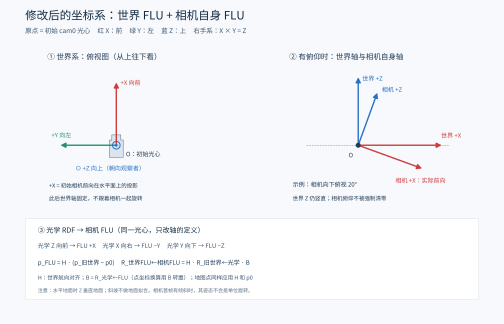

# Head dataset adapter

从 GitHub 克隆此分支（包含固定版本的依赖子模块）：

```bash
git clone --branch OKVIS2-X --recurse-submodules https://github.com/qiynxx/orbslam3_mocap.git OKVIS2-X
```

源码不包含本机 `datasets/`、`results/`、`build/` 或 `okvis2-local-deps/`。构建依赖遵循下方上游文档；Python适配脚本使用 NumPy、OpenCV、h5py、PyYAML，诊断脚本还使用SciPy。默认还需要参考ORB工程中的 `dataset_layout.py`，其位置可用 `head_to_okvis.py --orbslam-reference` 指定。GeographicLib可通过系统开发包安装；下方本地无sudo路径只说明本次测试机器的配置。

`profile_preferences.json` 记录的是本机验证过的输入路径和缓存。首次克隆没有转换缓存时会先导出原参数；要重建009优化配置，可先导出数据，再按下文 `prepare_drift_profile.py --gyro-noise 0.001 --acc-noise 0.01` 创建独立变体，将其导出文件夹传给 `run_head.sh`。验证结论不自动推广到其他数据集。

图形运行入口：`/home/wh/rk3576/OKVIS2-X/run_head.sh /数据集文件夹路径`。默认显示相机特征匹配窗口，并打开浏览器三维轨迹界面，替换原来的二维俯视图。结束后按相机窗口内任意键让命令退出，浏览器回放仍可使用。图形开关写入本次结果目录的 `okvis_gui.yaml`，原始导出配置保留。直接调用底层 `run.sh` 仍默认无窗口；可设置 `OKVIS_GUI=1` 开启，设置 `OKVIS_GUI_HOLD=0` 可在运行结束后自动关闭相机窗口。

运行产物放在原始数据集的 `slam/` 中，与 `video/` 同级。新转换缓存放在 `slam/exports/`，每次运行单独创建 `slam/runs/日期时间_随机后缀/`，其中保存轨迹CSV/TUM、地图、日志、统计、配置、三维服务信息和 `replay_3d.html`。已有工程内转换缓存可继续复用；新结果仍写到原始数据集下。传入导出目录时通过 `adapter_report.json` 找到原始数据集。底层 `run.sh` 未指定第二个结果目录参数时也采用此布局；显式第二参数可指定其他位置。

```text
head_000003/
├── head_000003.h5
├── video/
└── slam/
    ├── exports/     # 转换后的相机/IMU数据
    └── runs/
        └── 日期时间_后缀/
            ├── run.log
            ├── summary.json
            ├── trajectory_cam0.tum
            ├── okvis2-slam-final-ba_trajectory.csv
            ├── okvis2-slam-final_map.csv
            └── replay_3d.html
```

## 2026-10-13 漂移优化

修复了双目特征描述器首次初始化时跨相机写入的线程竞争。每个提取线程现在只初始化其持锁的相机。重新编译后，009 使用 `sigma_g_c=0.001`、`sigma_a_c=0.01` 的独立配置，替代之前的 0.007、0.05；不改变像素、坐标轴、外参或运动轨迹。010 保留原噪声配置，因为较强的 IMU 权重在010上使Z变化增大。

`profile_preferences.json` 只为已验证的原始数据路径指定优先配置，入口仍为 `run_head.sh /数据集文件夹`。直接传入导出目录会使用该目录本身的配置。新数据默认保持原参数，不自动套用009的调整。每次运行创建新结果目录，旧配置和旧结果保留。

009 的独立图像/陀螺仪极线检查使用58组背景匹配，最小残差候选为−20ms，分组为−28/−24ms，因此继续保留原−22.2ms，不把弱观测拟合成新的精确标定。噪声参数根据相邻IMU样本的稳健差分估计提出，再通过完整运行验证；这不是正式的Allan噪声或六面标定。

躯干遮罩也做了完整对照：单独启用会显著减少有效背景特征，009首尾距离反而增至1.39m，故没有默认启用。相关可选支持已保留，并修正上游mask极性错误（0排除、非0有效）；BRISK检测后、描述前过滤遮罩特征。`test_camera_mask.cpp` 检查mask极性、尺寸、投影与特征过滤。

原009无窗口运行本来已有约4.2cm首尾距离，图形运行曾达到79cm，因此不能只据首尾距离声称精度提升多少倍。对照报告保留旧无窗口结果、旧图形结果、线程修复单独结果和新参数重复结果。首尾距离是运动估计的一个观测量，没有真值时不等于定位误差，也不保证每次随机RANSAC/并行优化完全一致。

可创建额外独立参数对照，图像以符号链接复用：

```bash
python3 tools/head_dataset/prepare_drift_profile.py \
  --base datasets/head_000009_pinhole --output datasets/new_trial \
  --gyro-noise 0.001 --acc-noise 0.01
```

## 三维可视化与后期回放

```bash
# 传入运行结果目录，或原始数据集目录（自动查找最近的运行）
/home/wh/rk3576/OKVIS2-X/view_result.sh /home/wh/下载/head_0/head_000009
```

界面提供三维拖动旋转、平移、滚轮缩放、XY/XZ/YZ视图、视角按钮、时间滑条、播放速度、cam0光心姿态轴、XYZ时间曲线、相机同步帧和最终地图点云。选择不同运行可比较同一数据的重复运行；不同运行的世界航向可能不同，没有自动跨运行对齐。

实时读取每2秒更新。刷新保留视角与坐标范围；初始实时范围为XYZ各±2m，越界时手动点击“适配范围”。比例按米一致，不夸大Z轴，也不自动将运动轨迹旋转成水平。最终地图仅显示轨迹附近最多15000个点，避免远距离离群点占满视野。

“实时输出”按时间戳保留首次发布的位姿，避免最终优化回调把最后一帧历史输出覆盖。结束时全局轨迹、最终优化轨迹可独立选择，并叠加实时输出。轨迹差异和起终点距离不等于真值误差。

运行结束后生成 `replay_3d.html`。双击可离线查看轨迹、姿态、曲线和点云，无需网络；独立HTML不包含全部视频帧。用 `view_result.sh` 在本机回放可同时看原始转换图像。界面也可点击“保存离线回放HTML”。手动导出：

```bash
python3 /home/wh/rk3576/OKVIS2-X/tools/head_dataset/viewer.py --result 结果目录 --export
```

三维服务只监听127.0.0.1。单独运行 `view_result.sh` 时 Ctrl+C 关闭服务；随SLAM自动启动的服务PID记录在 `结果目录/viewer.pid`，关闭时可执行 `kill "$(cat 结果目录/viewer.pid)"`。URL记录在 `viewer_url.txt`。浏览器关闭不会停止SLAM。

本地 Plotly JavaScript 已打包，不依赖CDN。服务依赖Python与现有NumPy；界面支持WebGL浏览器。

此目录适配 `head-v3 H5 + video/*.mp4`。输入数据只读。默认使用 RGB 双目和 imu0，640×553、140°水平视野的虚拟针孔图像。暂不使用 IR、深度网络、GNSS、LiDAR 或语义建图。

## 构建

```bash
bash /home/wh/rk3576/OKVIS2-X/tools/head_dataset/build.sh
```

本机 GeographicLib 1.52 从 Ubuntu 包提取至 `/home/wh/rk3576/okvis2-local-deps`，无需 sudo。关闭 ROS2、Torch、RealSense、FindAnything 和 Ceres CUDA，构建仓库中的 `okvis_app_synchronous`，验证稀疏视觉惯性 SLAM。稠密 OKVIS2-X 需要额外深度/激光输入及对应构建，不包含在此次数据验证中。

## 导出并运行

```bash
python3 /home/wh/rk3576/OKVIS2-X/tools/head_dataset/head_to_okvis.py \
  --dataset /home/wh/下载/head_0/head_000009 \
  --output /home/wh/rk3576/OKVIS2-X/datasets/new_export \
  --acc-noise 0.05
python3 /home/wh/rk3576/OKVIS2-X/tools/head_dataset/verify_export.py \
  /home/wh/rk3576/OKVIS2-X/datasets/new_export
bash /home/wh/rk3576/OKVIS2-X/tools/head_dataset/run.sh \
  /home/wh/rk3576/OKVIS2-X/datasets/new_export
```

输出目录必须不存在，防止覆盖旧结果。已有两组完整导出：`datasets/head_000009_pinhole` 与 `datasets/head_000010_pinhole`；不带 `_pinhole` 的目录是初始原生等距鱼眼导出，用于对照。`--projection native` 保留原生鱼眼缩放；OKVIS 的 pinhole+equidistant 无法可靠表示后半球射线，默认针孔重投影更稳妥。重投影不改变光学轴或外参，也不将双目强行整平。

## 定义来源

- 默认从 `/home/wh/rk3576/orbslam3_mocap/Examples/Stereo-Inertial/scripts/dataset_layout.py` 加载运行时相机绑定、内参和规范外参。可用 `--orbslam-reference` 指定其他工程位置。
- `cam0=RGB_left`，`cam1=RGB_right`，单位为 m、rad/s、m/s²。按 H5 的 `frame_index` 解码，不能以数组行号代替视频帧号；视频可能含额外帧。
- 数据集外参 `T_CB` 表示相机←rig，IMU 配置 `T_SB` 表示 IMU←rig。OKVIS 的相机外参为 `T_SC = T_SB @ inverse(T_CB)`。估计器原始CSV位姿属于 IMU；适配层通过 `T_world_cam0 = T_world_imu @ T_SC0` 输出cam0光心位姿。
- 沿用 ORB 的 `imu_input_calibration` 解析 M900 legacy profile：IMU轴无需再次变换，已做六面校正的数据不重复扣偏置。未标定时间偏移时沿用该 profile 的 −0.0222 s，直接加到 IMU 时间戳；OKVIS 的 `image_delay=0`，避免双重校正。此偏移是参考工程的假设，不能视为本序列实测标定。`--imu-offset 0` 可做无偏移对照。
- 相机时间戳保留 CLOCK_MONOTONIC 原始纳秒值，不用 MP4 FPS 或 PTS 生成；双目唯一近邻匹配限差1ms，记录 `frame_mapping.csv`。只保留两端有25ms IMU覆盖的帧。
- 默认噪声来自内嵌标定。此次实测显式使用 `--acc-noise 0.05`，与009 ORB恢复配置一致；元数据原值为0.0012。两者均不是此次重新测出的噪声参数。
- `adapter_report.json` 保留偏移、外参定义、噪声选择及原始六面校正质量警告。

## 输出与验证范围

运行目录中的 `run.log`、`okvis2-slam-final_trajectory.csv`、`okvis2-slam-final-ba_trajectory.csv` 与 `okvis2-slam-final_map.csv` 来自上游。应用额外导出 `tracking_quality.csv`：quality 0=Good、1=Marginal、2=Lost，后台更新可能重复同一 state_id，统计时按 state_id 去重。

轨迹存在不代表视觉跟踪正常：丢跟踪时 IMU 仍可输出预测位姿。应同时检查质量状态、初始化/重初始化日志、轨迹有限值、覆盖和异常跳变。两组数据没有已确认的真值轨迹，不能据此给出定位精度或成功率保证。

`run.sh` 成功退出后调用 `summarize_run.py` 生成 `summary.json` 和 `trajectory_cam0.tum`。也可手动运行 `python3 tools/head_dataset/summarize_run.py 导出目录 运行结果目录`。TUM 的时间为原始单次启动时钟的秒数，不是 Unix 时间；世界坐标系由估计器初始化，Z轴朝上，默认导出与界面位姿属于 cam0 光心。

`verify_export.py` 是针对此次两组 M900 数据的集成检查，验证外参链、原始帧索引/纳秒时间映射、首帧像素与重投影、IMU单位和偏移符号；它不是其他传感器配置的通用校验器。

## cam0 光心位姿：世界和相机自身均使用FLU



默认使用 `trajectory_cam0.tum`，以及 `trajectory_cam0_live.csv`、`trajectory_cam0_final.csv`、`trajectory_cam0_ba.csv`。输出为 `T_worldFLU_cam0FLU`，四元数顺序xyzw，时间仍为CLOCK_MONOTONIC。相机光心的位置不受自身坐标轴重命名影响。

世界原点采用默认版本首帧cam0光心（最终BA优先，其次结束时轨迹，最后实时轨迹）。世界+Z保留估计器反重力方向；将初始光学+Z即实际前向投影到水平面并归一化作为世界+X；世界+Y = +Z × +X。此后世界坐标轴固定。初始相机前向恰好竖直时，水平航向没有定义，代码明确报错，不任意选一个方向。

相机自身也从光学RDF改为FLU：新+X=旧光学+Z，新+Y=旧光学−X，新+Z=旧光学−Y。相机自身轴随相机运动，世界Z则保持竖直，因此相机有俯仰/侧倾时首帧姿态不会被强制清成单位旋转。

转换为：`p_new = H @ (p_old - p0)`，`R_worldFLU_cam0FLU = H @ R_oldWorld_optical @ B`。其中H为世界航向对齐旋转，`B=R_optical_cam0FLU=[[0,-1,0],[0,0,-1],[1,0,0]]`。单个光学坐标点转换为FLU坐标时用 `B.T`，即 `(x,y,z)_RDF -> (z,-x,-y)_FLU`。不做地面平面拟合或漂移修正。

实时/最终轨迹、姿态轴、曲线、CSV/TUM、浏览器导出与新离线回放全部使用上述定义。所有版本和地图使用同一个H与p0。最终优化发布后以优化后的首帧更新H/p0，实时叠加轨迹也一起更新。默认版本首帧位置为零；其他版本可能保留优化前后的小差异。

地图新坐标文件为 `landmarks_cam0_world.csv`，完整导出地图点，不使用界面的距离过滤或15000点上限。`world_frame.json` 记录p0、H、B、参考版本及时间戳。浏览器CSV附带的IMU世界速度也乘H，偏置仍是IMU传感器轴下的状态（不旋转）。原始 `okvis2-*_trajectory.csv` 和原始地图保留上游坐标定义，不能直接与新FLU文件混用。

转换读取本次 `okvis_gui.yaml`（没有时读取导出配置）的cam0 `T_SC`，先计算 `T_oldWorld_optical = T_oldWorld_imu @ T_SC0`，再按上述公式转换。当前适配固定外参；启用在线外参标定时会拒绝静态转换，避免误用固定外参。

旧结果无需重跑SLAM：

```bash
python3 tools/head_dataset/summarize_run.py 导出数据目录 运行结果目录
python3 tools/head_dataset/viewer.py --result 运行结果目录 --export
```

旧独立HTML需重新生成，已运行的旧viewer服务需重启。测试：`python3 tools/head_dataset/test_pose_frames.py`（SciPy用于独立姿态校验）。
