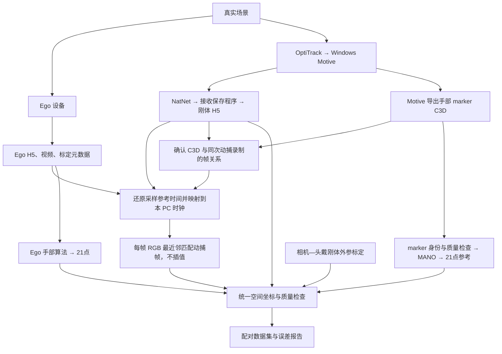

# 项目数据流

更新时间：2026-10-29。本文整理用户确认的数据流；待核实及待实施的环节不代表已完成。

## 总体流程



## 三类原始数据

| 数据 | 内容与作用 | 已知边界 |
| --- | --- | --- |
| Ego H5 及视频 | RGB、逐帧时间戳，以及相关 IMU、标定和元数据 | 历史样例已检查；当前固件现场结论不能无条件追认历史 H5 |
| NatNet 动捕 H5 | 当前会话保存原始帧、头戴刚体位置/姿态/有效性和时钟字段 | 当前采集只存刚体；它不是手部 marker GT |
| Motive C3D | 当前流程的手部 marker 三维轨迹来源 | 帧关系、单位、标签、裁剪和重采样尚未检查 |

Ubuntu上的归档按会话保存于 `data/sessions/<session_id>/raw/{ego,mocap,clocks}/`；Windows源文件路径仍保留在会话来源元数据中。文件位置不决定时间戳所属时钟域。

联合采集使用NatNet H5记录原始帧。NatNet/Zenoh订阅工具另可输出JSONL；JSONL字段不替代本次会话H5内容，也不表示采集流程由Zenoh承载。当前H5只有刚体是采集配置的事实，不是NatNet协议能力限制。

## 时间流

本 PC 单调时钟作为共同基准。连接同一 PC 并不自动同步；PC 接收时间也不等于采样时间。

### Ego H5 → RGB 采样参考时刻

当前设备证据支持 RGB `timestamp_ns` 来源于 Ego CLOCK_MONOTONIC 域的 CIF FS/SOF 软件时间，不是写盘或曝光中点。整帧默认参考中心行曝光中点：

```text
t_rgb_ego_ref = t_h5_rgb + delta_exposure_reference
t0_rgb = p0_ego + a_ego * (t_rgb_ego_ref - e0)
```

`delta_exposure_reference` 是有符号修正，依赖曝光、行位置及尚待标定的传感器物理相位；`e0`、`p0_ego` 是对应时间原点，`a_ego` 描述时钟速率差。约 44 ms 的 DQBUF 延迟不能作为曝光修正。此前约 −0.4 ms 只是简化模型估算，不是小于 1 ms 的已验证误差界。滚动快门图像各行仍对应不同时刻。

### 动捕 H5 → 动捕采样时刻

先核实 H5 实际字段和写入来源：

- 若保存 `CameraMidExposureTimestamp`：按当次服务端 tick 频率换算，再由 Windows 高精度时钟映射到 PC，得到 `t0_mocap`。
- 若仅保存 PC 接收时间：须有额外同步依据才能还原采样时刻，不能减一个假定的固定传输延迟。
- 若保存 `motive_timestamp` 或其他字段：先核实语义、单位及相位。

现场记录的 NatNet 服务端频率为 10 MHz；实际 H5 是否保存曝光中点及频率尚未确认。

### C3D → 同次动捕时间轴

确认录制身份、导出区间、首帧、采样率、帧号关系及是否重采样，不能默认 C3D 第一帧对应刚体 H5 第一帧。对应关系确认后，才能为 C3D 样本赋予动捕 PC 采样时间。若导出改变采样网格，应明确记录处理方法和误差，不能隐式插值或假定逐帧对应。

### 最近邻配对

```text
j = argmin_j abs(t0_mocap[j] - t0_rgb[i])
dt = t0_mocap[j] - t0_rgb[i]
```

每帧 RGB 保留所选动捕原始帧及对应 C3D 样本，不插值。`t0_rgb` 和 `t0_mocap` 是两个实际采样参考时刻，不因配对就严格相等。稳定 120 Hz、无丢帧且目标有前后覆盖时，离散时间差最多约 ±4.17 ms，时钟和曝光误差另计。边界、丢帧及无效数据应显式标记，不静默跳到更远的有效帧。

## 空间流与21点评测

1. 核实 C3D marker 标签、左右手和单位，检查身份跳变、遮挡及缺失。
2. 按 marker 与 MANO 表面对应关系拟合手部，生成动捕世界系 W 中的21点参考；marker 并非关节中心，拟合残差和有效性需保留。
3. 从刚体 H5 取得所选动捕帧的头戴位姿 `T_WB[j]`。头戴持续运动，不能只使用初始位姿。
4. 独立标定相机/头戴参考系 C 到头戴 marker 刚体系 B 的固定外参 `T_BC`。约定 `T_AB` 把 B 系点变到 A 系。
5. 若 Ego 输出在 C 系，转换参考点后比较：

```text
p_C_GT[j] = inverse(T_WB[j] * T_BC) * p_W_GT[j]
比较 RGB 帧 i 的 p_C_Ego[i] 与所选帧 j 的 p_C_GT[j]
```

二者存在 dt，运动时这会进入评测误差。刚体与 marker 应对应同一动捕时刻。若 Ego 输出在本段初始化世界系 E，则还需建立该段 E 与 W 的关系并检查漂移、重定位。实际输出坐标系、尺度、21点顺序仍待确认。图像投影需匹配相机内参、畸变及旋转/镜像图像域。

## 保存结果与待完成工作

### 仓库路径（2026-10-29）

每次采集的标准目录为 `data/sessions/<session_id>/`：`session.json`记录会话身份和原始状态，`raw/`保存设备原件与对时探针，`capture/`保存控制事件，`runs/<run_id>/`保存每次独立离线处理。时间配对写入 `runs/<run_id>/sync/`，对齐刚体 H5 写入 `runs/<run_id>/aligned/`，OKVIS 位姿归入相应运行的 `ego/okvis/`。来源不明的旧文件放在 `data/unassigned/`，测试样例位于 `data/samples/`。历史路径与原件保留；迁移映射和哈希记录见 `reports/migrations/layout-20261029-v1/`。

每组配对建议保存 session_id、camera_id、RGB 帧号与原始时间、曝光参考修正、PC 参考时间、动捕原始帧号与时间、PC 采样时间、C3D 索引、dt、各环节有效性及双方21点。

每段保存原始文件对应关系、时钟域及单位、映射参数和有效区间、同步依据及残差、C3D 导出设置与帧映射、相机和外参、算法与拟合版本。原始数据不覆盖。

当前待完成：检查实际动捕 H5/C3D 及写入程序；核实 Ego H5 写入链和曝光参考修正；求解 Ego→PC 与动捕→PC 映射并检查漂移；建立 C3D 帧映射；完成外参、MANO 拟合与最近邻评测。尚无已验证的完整同步精度或最终手部精度结果。

### 数据路径最新补充（2026-10-28）

用户指定 NatNet 刚体 H5 保存在本 PC `/home/current/syz/ego_hand_ground_truth/mocap_data/`。本次实际检查目录存在但为空，尚无 H5 可解析。Windows `~/Desktop/syz/ego-hand/` 已检查含 `egotest_001.c3d` 和 `.tak`；该 C3D 为120 Hz、990帧、7个 `ego:Marker_*` 点，手部身份仍待确认。以此条及 `时间同步审查测试记录_20261028.md` 的最新检查为准。

### 最新范围澄清

用户确认 egotest_001.c3d 是临时录制的格式测试样例，尚未开始手部采集；其中只有 ego 主体不是数据异常，也不需要现在补手部数据才能继续时钟审查。该文件用于验证C3D格式，不能与后续独立录制的刚体H5强行逐帧对应。mocap_data 当前已有 natnet_rigid_20261028_223354_5s.h5，600帧原始刚体数据，之前“目录为空”的记录仅为历史检查状态。
